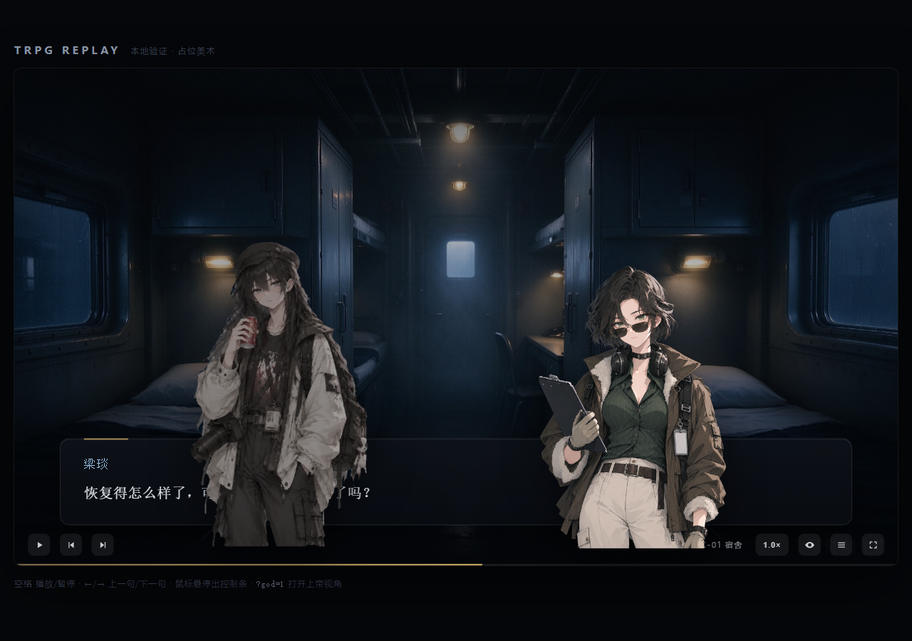

# trpg-replay · 跑团 log 动态回放器

把跑团平台导出的聊天日志，渲染成可嵌入博客的**动态跑团记录**（视觉小说式回放）。

> 引擎与数据分离：播放器只认 `data/replay.json`，换一份 log 不需要改播放器。



## 状态

- [x] 日志解析器：原始 JSON → 结构化回放脚本（`trpg-replay/1` schema）
- [x] 掷骰解析：理智检定 / 技能检定 / 奖励惩罚骰 / 暗骰 四种格式全部结构化
- [x] 场景切分、角色表、旁白归属异常检测
- [x] 播放器骨架：`<trpg-replay>` Web Component（16:9、Shadow DOM）
- [x] 打字机、场景卡、掷骰卡、SAN 血条、私密旁白标记、上帝视角开关
- [ ] 真美术接入（背景 / 立绘 / 表情差分）
- [ ] BGM 与音效
- [ ] 打包产物入库 + jsDelivr 分发

## 目录

```
src/
  index.ts      <trpg-replay> 自定义元素（属性 / 方法 / 事件）
  player.ts     播放引擎：时间轴、打字机、场景、掷骰、SAN
  style.ts      Shadow DOM 内的全部样式
  types.ts      replay.json 与 assets.json 的类型
demo/
  index.html    本地验证页
  main.ts       demo 引导（?seq= / ?god= / ?speed=）
tools/
  inspect_log.py   一次性统计：log 里有什么、有什么坑
  build_replay.py  正式解析器：原始 log → data/replay.json
  snapshot.mjs     本地验证：无头 Chrome 截图 + 导出 Shadow DOM
  debug-page.mjs   挂载排查
data/
  replay.json   回放脚本（播放器唯一的输入）
docs/
  preview-*.png 效果截图
```

## 本地验证

```bash
npm install
npm run dev          # http://127.0.0.1:5188/demo/
```

demo 页支持几个调试参数：

| 参数 | 作用 |
|---|---|
| `?seq=69` | 跳到第 `seq` 条事件并停住（截图校对用） |
| `?god=1` | 默认打开上帝视角（显示暗骰与 OOC） |
| `?speed=2` | 2 倍速 |

本地自查工具（都需要本机 Chrome）：

```bash
# 截图 + 导出 Shadow DOM，用来核对某一帧的排版
node tools/snapshot.mjs --url "?seq=69" --wait 1500 --out .tmp/check.png

# 交互回归：连点「下一句」是否每次只前进一条、打字时文本是否抖动
node tools/click-test.mjs
```

## 嵌入博客

```html
<script type="module" src="https://cdn.jsdelivr.net/gh/Maple127667/trpg-replay@main/dist/trpg-replay.mjs"></script>

<trpg-replay src="/data/beihai9.json" autoplay></trpg-replay>
```

React 里直接当自定义元素用（React 19 原生支持）：

```tsx
<trpg-replay ref={ref} src="/data/beihai9.json" />
```

### 属性

| 属性 | 说明 |
|---|---|
| `src` | replay.json 地址（必填，或直接给元素 `data` 属性赋值） |
| `assets` | assets.json 地址（可选，缺省用内置占位美术） |
| `god` | `"true"` 默认显示暗骰 / OOC |
| `speed` | 倍速，默认 1 |
| `autoplay` | `"true"` 自动播放 |
| `start` | 从某个 `seq` 开始 |

### 方法

`play()` / `pause()` / `toggle()` / `next()` / `prev()` / `setGod(bool)` / `setSpeed(n)` / `goToScene(i)` / `seek(seq)`

## 数据格式

```jsonc
{
  "schema": "trpg-replay/1",
  "meta":   { "title": "北海九号", "startedAt": "…", "durationSeconds": 18484 },
  "cast":   [ { "id": "liangyan", "name": "梁琰", "role": "pc", "count": 96 } ],
  "scenes": [ { "index": 0, "label": "甲板层 · 起雾", "startSeq": 3, "endSeq": 100 } ],
  "events": [
    { "seq": 15, "type": "dialogue", "speaker": "wenkele", "text": "…", "ms": 4200 },
    { "seq": 69, "type": "check",    "speaker": "liangyan",
      "check": { "kind": "san", "roll": 23, "target": 75, "level": "成功", "lossValue": 0 } }
  ]
}
```

`type`：`narration`（旁白）/ `dialogue`（对话）/ `action`（行动）/ `thought`（心声）/
`check`（掷骰）/ `hidden_check`（暗骰）/ `ooc`（闲聊）/ `marker`（场景切换）。

每条事件保留 `seq` 与 `raw` 原文，便于回溯校对。

## 素材接口

美术就位后加一个 `assets.json`，不用改代码：

```jsonc
{
  "scenes": { "0": "/art/deck-fog.webp", "3": "/art/server-room.webp" },
  "characters": {
    "liangyan": { "default": "/art/liangyan.webp" },
    "wenkele":  { "default": "/art/wenkele.webp" }
  }
}
```

立绘建议 1200×1800 透明 PNG，背景 1920×1080。缺图时播放器自动退回渐变占位。

## 重新解析日志

`tools/build_replay.py` 顶部的 `SRC` 指向原始导出，换 log 时改这一行：

```bash
python tools/build_replay.py
```

## 素材脚本

`make_transparent.py` 把白底角色插画批量抠成透明 PNG（供立绘使用）。
